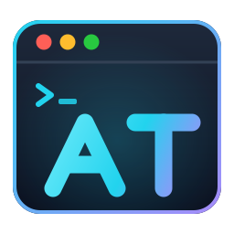
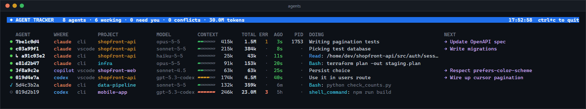
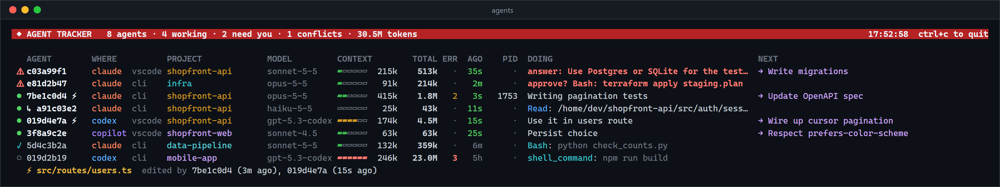
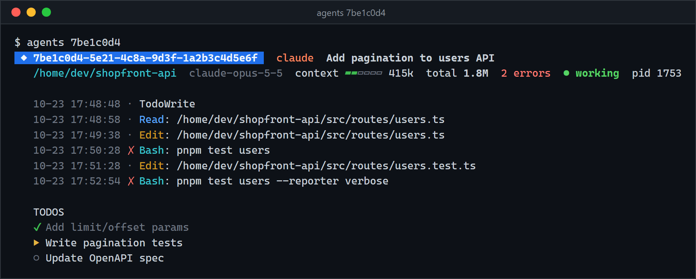
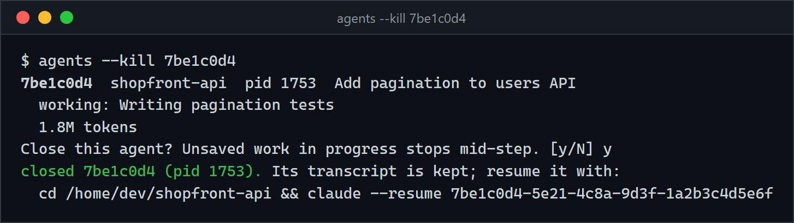

<p align="center"></p>

<h1 align="center">agent-tracker</h1>

**A live dashboard for all your coding agents, in the terminal or in VS Code.** Run 15 agents across 15 projects and see, in one screen, what each one is doing right now, which ones are **blocked waiting on you**, which ones are **editing the same file**, which ones are **failing in a loop**, and how full each one's **context window** is. Close an agent from the dashboard when it goes off the rails.

It tracks **Claude Code**, **OpenAI Codex**, and **GitHub Copilot Chat** agents, wherever they run: a terminal, VS Code, or the desktop app. It works on Windows, macOS, and Linux.



It's color-coded. The title bar turns **red** when an agent needs you or files conflict, and blocked agents jump to the top. ERR turns red when an agent is failing over and over. The context bar goes green, then yellow, then red as the window fills.

## What it shows



| Column | Meaning |
|---|---|
| status | **⚠ needs you**: blocked on a question or a permission prompt · **●** working · **✓** finished its turn, waiting for your next prompt · **○** idle |
| AGENT | session id. `↳` = subagent spawned by another agent. **⚡** = this agent edited a file another agent also edited in the last hour |
| WHERE | which agent (`claude`, `codex`, `copilot`) and where it runs (`cli`, `vscode`, `desktop`, `exec`) |
| PROJECT | the directory the agent is working in |
| MODEL | model of the latest turn |
| CONTEXT | how full the context window is right now: 1M for current Claude models, the window Codex reports, 200k otherwise |
| TOTAL | all tokens processed, including cached input |
| ERR | failed tool calls (non-zero exit codes, failed edits, rejected calls). **Red** = 3+ of its last 5 calls failed, so it's probably looping |
| AGO | time since its last action |
| PID | process id of a live Claude Code agent (`·` = not running, or a tool that doesn't record it). These are the agents you can [close](#closing-agents) |
| DOING | the task it marked in-progress, else its last tool call. For a blocked agent: the question it asked or the call waiting for approval |
| NEXT | the next pending item on its todo list / plan |

Drill into one agent for a timestamped timeline of every command and file it touched (`✗` = failed, `…` = still pending), plus its full todo list:



## VS Code extension

The same tracker as a VS Code sidebar, under [`vscode-extension/`](vscode-extension):

- an **Agents** view in the activity bar: one row per agent with a status icon, project, context %, and current action. Expand a row for its todo list and last 30 actions; hover for model, context window, tokens, and errors
- a **status bar** item with how many agents are working, need you, or conflict. It turns yellow when something needs you
- **notifications** when an agent needs you, finishes, or a file conflict appears
- **✕** on a row closes that agent (asks first); the **history** button opens its timeline; the **terminal** button opens the full live table
- a filter button for **only this workspace's agents**

Install it from the VS Code Marketplace (search **AT Agent Tracker**) once published, or download the `.vsix` from the [latest release](https://github.com/NiloyBhattacharjee/agent-tracker/releases/latest) and run `code --install-extension at-agent-tracker-*.vsix`.

To build it yourself (needs Node.js):

```bash
cd vscode-extension
npx @vscode/vsce package          # → at-agent-tracker-0.1.0.vsix (bundles tracker.py)
code --install-extension at-agent-tracker-0.1.0.vsix
```

It needs Python 3.9+ on PATH, or set `agentTracker.pythonPath`. Under the hood it runs `tracker.py --json --stream`, a single long-running process that prints one JSON snapshot per refresh, so transcripts are only re-parsed when they change.

## How it works

Nothing to configure: no hooks, no daemon, no API keys. Agents already write a full transcript of every session to disk, including tool calls and their results, timestamps, token usage, and todo lists. `agent-tracker` just reads them:

| Agent | Where it runs | Transcripts |
|---|---|---|
| Claude Code (incl. subagents) | terminal, VS Code, desktop | `~/.claude/projects/**/*.jsonl` |
| OpenAI Codex | CLI, VS Code | `~/.codex/sessions/**/rollout-*.jsonl` |
| GitHub Copilot Chat | VS Code (stable, Insiders, VSCodium) | `<VS Code user dir>/workspaceStorage/*/chatSessions/` |

The VS Code user dir is `%APPDATA%\Code\User` on Windows, `~/Library/Application Support/Code/User` on macOS, and `~/.config/Code/User` on Linux.

Because it reads these global folders, **one install sees every agent in every project**. Files are only re-parsed when they change, so refreshing every 2s is cheap.

How the signals are derived:

- **Needs you:** the agent asked a question (`AskUserQuestion`, `ExitPlanMode`, Codex `request_user_input`), or a tool call has no result after 20s (90s for shell commands, subagents, and web calls, which can legitimately run long). An agent at a permission prompt looks exactly like this. A shell command that runs longer than 90s will also show up here, so the label reads `approve?`.
- **Conflicts:** two agents' file edits (Claude `Edit`/`Write`/`MultiEdit`/`NotebookEdit`, Codex `apply_patch`, Copilot's edit tools) hit the same path within an hour. Edits made through shell commands (`sed -i`, `>`) aren't detected.
- **Errors:** Claude Code's `is_error` tool results, and Codex and Copilot non-zero terminal exit codes.
- **Context window:** the size of the latest request (input + cache + output), measured against the model's window.

## Closing agents



Claude Code records each running session in `~/.claude/sessions/<pid>.json`, including the process start time. Before closing anything, `agent-tracker` checks that the PID is still that exact process, so a PID the OS has reused for something else is never touched. On macOS and Linux it checks that the process is still a `claude`/`node` binary. It checks again right before killing. The agent's process and the shell commands it started are terminated (`taskkill /T` on Windows, `SIGTERM` elsewhere). The transcript stays, so `claude --resume` picks the session back up. Add `-y` to skip the confirmation.

Only Claude Code sessions can be closed this way: Codex and Copilot don't record which process owns a session. Subagents run inside their parent, so close the parent.

## Desktop notifications

While the live dashboard is running, you get a native desktop notification when:

- **⚠ an agent needs you:** it asked a question or is waiting on a permission prompt
- **✓ an agent finished its turn** and is waiting for your next prompt
- **⚡ a new file conflict appears**

Each one says which project and agent, plus the question or the waiting command. Notifications only fire on *changes*, so an agent that stays blocked doesn't spam you. Starting the tracker doesn't replay old states either.

| OS | Mechanism (no install needed) |
|---|---|
| Windows | native toast via PowerShell |
| macOS | Notification Center via `osascript` |
| Linux | `notify-send` (libnotify) |

```bash
agents --test-notify   # send a test notification
agents --no-notify     # dashboard only, no notifications
```

(The VS Code extension uses VS Code's own notifications instead.)

## Install

Requires Python 3.9+. Zero dependencies. Tested on Windows, macOS, and Linux with Python 3.9 and 3.13 (see the CI workflow).

```bash
pip install git+https://github.com/NiloyBhattacharjee/agent-tracker
```

or run it straight from a clone:

```bash
git clone https://github.com/NiloyBhattacharjee/agent-tracker
python agent-tracker/tracker.py
```

## Usage

```bash
agents                 # live dashboard, all agents active in the last 24h
agents --here          # only agents working in the current directory
agents -p api-server   # only projects whose path contains "api-server"
agents --hours 2       # change the time window
agents --once          # print once and exit (pipe-friendly, no colors when piped)
agents -n 5            # refresh every 5s
agents 4cf2f29c        # timeline + todos for one agent (any id prefix)
agents --kill 4cf2f29c # close a running Claude Code agent (shows what it's doing, asks first)
agents --json          # one JSON snapshot; --json --stream prints one per refresh
agents --no-notify     # live dashboard without desktop notifications
agents --test-notify   # check notifications work on this machine
```

Set `NO_COLOR=1` to disable colors. Thresholds (`STUCK_SECS`, `SLOW_STUCK_SECS`, `CONFLICT_SECS`, `ACTIVE_SECS`) are constants at the top of `tracker.py`.

## Adding another agent

Every source is one entry in `SOURCES` in `tracker.py`: a name, a glob for its transcript files, and a parser that fills in the agent's `cwd`, `where`, `model`, `tokens`, `ctx`, `edits`, `todos`, and calls `add_event` / `finish_event` for each tool call. See `parse_codex` or `parse_copilot` for examples. PRs for Gemini CLI, Aider, OpenCode, Cline, etc. welcome.

## Notes

- **NEXT** is only filled when the agent keeps a todo list (Claude Code's `TodoWrite`, Codex's `update_plan`, Copilot's todo tool). Agents that don't plan show only DOING.
- Copilot's chat-session format is VS Code-internal and may change between VS Code releases.
- "Processes" here means the commands each agent runs, read from its transcript. Apart from the PID check for closing agents, there's no OS process inspection.

## Releasing

Push a version tag and the [publish workflow](.github/workflows/publish.yml) runs the tests, packages the extension with that version, attaches the `.vsix` to a GitHub release, and publishes it:

```bash
git tag v0.2.0 && git push origin v0.2.0
```

Publishing to the stores is skipped until you add their tokens as repository secrets (Settings → Secrets and variables → Actions):

| Secret | Where to get it | Publishes to |
|---|---|---|
| `VSCE_PAT` | dev.azure.com → User settings → Personal access tokens; Organization **All accessible organizations**, scope **Marketplace → Manage** | VS Code Marketplace |
| `OVSX_PAT` | open-vsx.org → Settings → Access Tokens (run `npx ovsx create-namespace NiloyBhattacharjee -p <token>` once first) | Open VSX (Cursor, VSCodium, Windsurf) |

## Test

```bash
python test_tracker.py          # tracker (all platforms)
node vscode-extension/test.js   # VS Code extension, against a stubbed vscode API
```

## License

MIT
