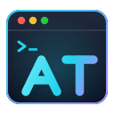

# AT Agent Tracker for VS Code

See every coding agent you have running, across all your projects, from the VS Code sidebar: **Claude Code** (terminal, VS Code, or desktop), **OpenAI Codex** (CLI or VS Code), and **GitHub Copilot Chat** agent sessions.

- **Sidebar:** one row per agent with a status icon, its project, how full its context window is and how many tokens are left before it compacts (◔ past 80%, ⟳N = compacted N times), and what it's doing right now. Expand a row to see its todo list and its last 30 actions (failed ones are marked).
- **Status bar:** how many agents are working, how many **need you**, how many **file conflicts** exist, and your **Codex plan usage** (if you use Codex). It turns yellow when something needs your attention.
- **Notifications** when an agent is blocked on a question or permission prompt, finishes its turn, passes 80% of its context window, or edits a file another agent is also editing, and when a Codex plan window passes 80%.
- **Close an agent** with the ✕ button on its row (Claude Code agents with a live process). You're asked first, and the session stays resumable with `claude --resume`.
- **Timeline** button on a row: every command and file the agent touched, with timestamps.
- **Terminal dashboard** button: the full-width live table in a terminal.

Hover a row for details: model, context window (tokens used / window size, tokens left before compacting), total tokens, failed tool calls, next todo item, and the working directory.

## Requirements

Python 3.9+ on your PATH (`python3`, `python`, or `py`), or set `agentTracker.pythonPath`. Nothing else: the extension runs the bundled zero-dependency `tracker.py`, which reads the transcripts the agents already write to disk. It doesn't use hooks, API keys or network access.

## Settings

| Setting | Default | |
|---|---|---|
| `agentTracker.pythonPath` | *(auto)* | Python 3.9+ to run the tracker |
| `agentTracker.refreshSeconds` | `3` | refresh interval |
| `agentTracker.hours` | `24` | show agents active within this many hours |
| `agentTracker.onlyThisWorkspace` | `false` | only agents working in this window's folder (filter button in the view title) |
| `agentTracker.notifications` | `true` | notify on needs-you / finished / context nearly full / conflict / Codex limit |

Full docs and the command-line version: https://github.com/NiloyBhattacharjee/agent-tracker
